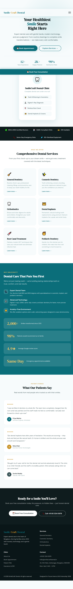
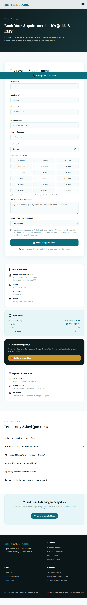

# SmileCraft — Dental Clinic Website

A responsive dental clinic website redesign focused on usability, clear service information, and appointment enquiries.

## 📌 Project Overview

SmileCraft is a website redesign project completed as part of the Future Interns UI/UX Internship in 2026. The goal was to improve the presentation of dental services and create a clearer path for visitors who want to learn about treatments or contact the clinic.

The project includes three pages: a homepage, a services page, and a contact/appointment page.

## ✨ Key Features

- Responsive homepage layout
- Dental services information and treatment details
- Contact and appointment enquiry interface
- Consistent typography, colours, and visual hierarchy
- Desktop and mobile page designs
- Clear navigation and calls to action

## 🖼️ Screenshots

### Homepage

**Desktop**



**Mobile**


### Services Page

**Desktop**


**Mobile**


### Contact and Appointment Page

**Desktop**



**Mobile**


## 🛠️ Technologies Used

- HTML5
- CSS3
- JavaScript

## 📂 Project Structure

```text
.
├── index.html
├── services.html
├── contact.html
├── homepage-desktop.png
├── homepage-mobile.png
├── services-desktop.png
├── services-mobile.png
├── contact-desktop.png
├── contact-mobile.png
├── DESIGN_RATIONALE.md
└── README.md
```

## 🚀 Getting Started

1. Clone or download this repository.
2. Open the project folder on your computer.
3. Open `index.html` in your browser.
4. Navigate through the homepage, services, and contact pages.

No build step is required for a basic static HTML project.

## 🎨 Design Rationale

The design focuses on:

- Clear navigation and content hierarchy
- Consistent typography and colour usage
- Responsive desktop and mobile layouts
- Accessible, readable interface elements
- Clear calls to action for contacting the clinic

For the full design rationale, see [DESIGN_RATIONALE.md](DESIGN_RATIONALE.md).

## 🎓 Project Context

**Program:** Future Interns UI/UX Internship  
**Task:** Website redesign  
**Year:** 2026

This project was completed as part of an internship learning experience.

## 🔮 Possible Future Improvements

- Add form validation and meaningful submission feedback
- Connect appointment enquiries to a backend service
- Improve accessibility and keyboard navigation
- Test across different screen sizes and browsers

These are potential improvements, not claims that the features are already implemented.
